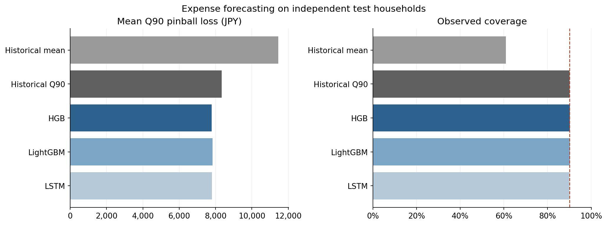

# 家計の支出予測と現金制約下の投資額決定

家計の変動費を予測し、生活費と最低準備金を確保した上で、毎月いくら投資できるかを検証するシミュレーションです。

3日間の楽天インターンでは、HGBを用いた家計の変動費予測に取り組みました。その後、個人で実験を整備し、対照手法、LightGBM・LSTM、独立較正、投資上限の感度分析を追加しました。このリポジトリには、現在の検証コードと結果をまとめています。

実際の個人取引データは使用していません。総務省「家計調査」の平均規模を参考に、各家庭の月次収支を生成しています。投資収益率は予測しません。

## 結果

10シード、各500テスト家庭、各12か月の基準環境における結果です。分位点予測器には、それぞれ独立した較正を適用しています。

| 方法 | Q90損失（円） | 支出カバー率 | 月平均投資額（円） | 準備金不足率 |
| --- | ---: | ---: | ---: | ---: |
| 投資なし | — | — | 0 | 10.15% |
| 現金制約付き定額投資 | — | — | 30,703 | 15.12% |
| 履歴平均 | 11,447 | 60.98% | 31,122 | 13.23% |
| 履歴Q90（較正） | 8,342 | 90.045% | 30,644 | 12.18% |
| HGB（較正） | 7,787 | 90.137% | 30,718 | 12.20% |
| LightGBM（較正） | 7,830 | 90.132% | 30,713 | 12.21% |
| LSTM（較正） | 7,798 | 89.983% | 30,716 | 12.21% |

HGBは較正済み履歴Q90より予測損失を **6.66%** 改善しました。一方、準備金不足率の差は **+0.0217ポイント**、95%区間は **[−0.0867, +0.1417]ポイント** で、資金リスク低下の明確な証拠は得られませんでした。月平均投資額の差は+74.03円 [35.01, 115.27]円です。



投資上限が効く月や双方が0円を選ぶ月では、予測が変わっても投資額が変わりにくくなります。千円単位の切り捨ても関係します。予測損失の改善と、意思決定への効果を分けて確認しました。

## 実験の流れ

1. **生成**：仮定と乱数から、実現値である収入Y、固定費F、予定支出P、変動費Xを作ります。総支出はE=F+P+Xです。
2. **予測**：過去12か月のX、当月の既知Y/F/P、暦月の情報から、Xの90%分位点を推定します。当月の実現値Xは入力に含めません。
3. **決定**：予測した支出予算、現金、既知費用、最低準備金、投資上限から投資額を計算します。
4. **評価**：予測は実際のXと比較します。月末残高は実際の総支出Eを差し引いて計算します。

HGB、LightGBM、LSTMの目的変数は変動費Xです。履歴平均は平均予測の比較基準です。現金残高そのものは予測器の特徴量に含めず、投資額を計算する段階で使います。

## 実行

Python 3.12を使用します。以下はリポジトリのルートで実行します。

```sh
python -m venv .venv
```

仮想環境の有効化は、Windows PowerShellでは `.venv\Scripts\Activate.ps1`、macOS/Linuxでは `source .venv/bin/activate` です。

### HGBと基準手法の動作確認

```sh
python -m pip install -e ".[dev]"
pytest -q -m "not extended"
household-cashflow run --config configs/smoke.json --output runs/smoke
household-cashflow verify --run runs/smoke
```

`smoke.json`は1シード・250家庭・短い学習で、生成、学習、較正、対照実験、上限網羅、区間計算、帳簿検査を確認する設定です。掲載結果の再現には次の完全設定を使います。既存の実行結果を上書きしないため、出力先は空のディレクトリを指定します。

### LightGBM・LSTMを含む完全設定

```sh
python -m pip install -e ".[extended,dev]"
pytest -q
household-cashflow run --config configs/full.json --extended --output runs/full
household-cashflow verify --run runs/full
household-cashflow plot --tables runs/full/tables --output runs/full/figures
```

完全設定は10シード、各2,500家庭×48か月です。LSTMもCPUで学習します。1シードだけ確認する場合は `--seeds 20261102` を追加できます。拡張モデルの短い動作確認は `configs/smoke.json` と `--extended` を組み合わせます。

### 保存済み結果の確認

```sh
household-cashflow check-reference
household-cashflow plot --tables results/reference --output docs/figures
```

`results/reference`は整理前の実験で保存した集計結果です。CSVのハッシュと主要結果を検査できます。生成データ、モデル、全月次帳簿はリポジトリに含めず、実行時に`runs/`へ保存します。参考結果の依存バージョンは[環境記録](results/reference/environment.json)にあります。異なる依存バージョンや実行環境での再学習が、数値まで完全に一致するとは限りません。

## データと検証設計

| 用途 | 家庭数／シード | ラベル期間 | 役割 |
| --- | ---: | --- | --- |
| 訓練 | 1,400 | 13–36月 | モデルと標準化器の学習 |
| 検証 | 300 | 25–36月 | 候補選択、定額投資目標の選択 |
| 較正 | 300 | 25–36月 | 各Q90予測器の補正 |
| テスト | 500 | 37–48月 | 凍結した手法の最終比較 |

家庭は用途間で重複しません。検証用の初期状態は24月末までの情報、テスト用の初期状態は36月末までの情報で設定します。信頼区間はシードと家計の二段階ブートストラップで計算し、手法間で同じ再抽出を適用します。同一家計の12か月をまとめて扱います。

比較条件、生成式、投資計算、各指標の定義は[実験方法](docs/methodology.md)、観測した効果と区間は[結果の説明](docs/results.md)に記載しています。

## 構成

```text
src/household_cashflow/
  data.py             模擬収支とストレス条件
  features.py         過去情報からの特徴量
  calibration.py      独立家庭による分位点補正
  models/             HGB、LightGBM、LSTM
  allocation.py       解析解と独立した列挙検証
  backtest.py         同一外生経路上の月次投資判断
  metrics.py          手法間で対応を保った区間推定
  experiment.py       学習から最終評価までの実行
  verify.py           予測と現金帳簿の検査
configs/              完全設定と短い動作確認設定
tests/                時間境界、較正、制約、再現性のテスト
results/reference/    保存済みの集計結果
docs/                 方法、結果、図
```

## 結論の範囲

公開統計は平均規模の参考であり、家庭ごとの波動や突発支出の分布は仮定です。通常環境の周辺カバー率が約90%でも、各家庭や分布変化後の安全を保証するものではありません。投資0円でも予測上の準備金条件を満たせない月は別途記録します。

この比較は、指定した生成機構・特徴量・候補探索範囲での検証です。複雑なモデルが実データでも常に無効であるとは結論できません。

出典：[総務省「家計調査」2025年、男女・年齢階級別、単身勤労者世帯](https://www.e-stat.go.jp/stat-search/files?stat_infid=000040409816)。平均可処分所得311,571円、平均消費支出179,225円を規模の基準に使用しています。
