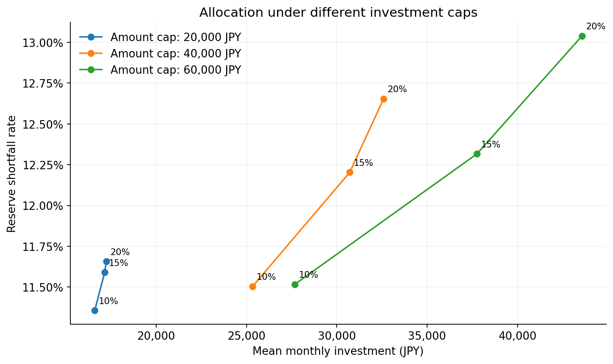
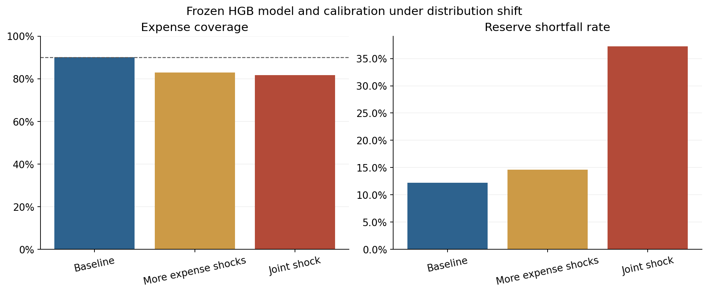
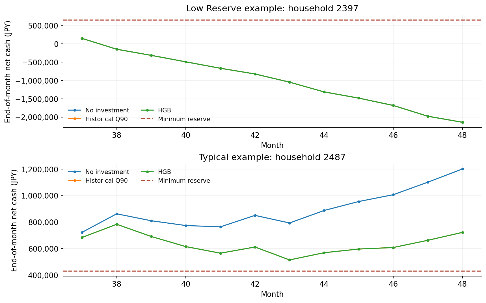

# 結果の説明

数値は[保存済み集計](../results/reference/)に対応します。基準環境、10シード、各500家庭×12か月、独立較正後の比較です。単位は円、率差はパーセントポイントです。

## 予測と投資判断

| HGB − 較正履歴Q90 | 差 | 95%区間 |
| --- | ---: | ---: |
| Q90損失 | −555.25円 | [−647.81, −457.17]円 |
| 月平均投資額 | +74.03円 | [+35.01, +115.27]円 |
| 準備金不足率 | +0.0217ポイント | [−0.0867, +0.1417]ポイント |
| 平均不足額 | −43.05円 | [−189.57, +112.64]円 |

予測損失は6.66%減少しました。投資額には小さい増加がある一方、準備金不足率や不足額の改善は明確ではありません。差の区間が0を含むことは、二つの方法の等価性を証明するものでもありません。

定額投資との比較では、HGBの月平均投入額は14.72円多く、95%区間は[−155.84, +194.30]円でした。準備金不足率は2.9183ポイント低く、区間は[−3.3817, −2.5149]ポイントでした。単純な定額対照に対する効果と、較正履歴Q90に対する追加効果を分けて解釈しています。

LightGBMはHGBの予測損失を上回り、LSTMとの差の区間は0を含みました。追加モデルによる安定した投資判断の改善は確認できませんでした。候補数・特徴量・生成仮定を変えた場合まで一般化はできません。

## 上限の影響

主上限40,000円/15%では、HGBの真上限制約率は84.57%でした。HGBと較正履歴Q90の予測差が1円を超える月に限ると、97.44%で最終投資額が一致しました。

上限を60,000円/20%にすると、一致率は96.02%でした。上限のほかに、現金余力、双方の0円選択、千円単位の切り捨て、異なる残高経路も影響します。この比較だけから各要因の独立した因果寄与は求められません。

上限緩和により、HGBの月平均投資額は30,717.97円から43,565.10円に増えますが、準備金不足率も12.2033%から13.0383%へ上がります。一致率の低下だけで上限緩和を望ましいとは判断できません。

## 分布変化と失敗例

基準環境のHGB支出カバー率は90.1367%でした。突発支出確率18%では82.8483%、複合ショックでは81.67%まで低下しました。学習時の環境に対する較正を、別の環境でそのまま安全保証として使うことはできません。

投資なしでも準備金不足率は10.15%です。HGBの基準環境では、共通基準の予測リスク制約が不可行な月は13.7017%でした。資金状態が厳しい家庭では、投資額を0円にするだけでは準備金を維持できません。

家計例は失敗の形を説明するために選んだもので、人口全体の代表例ではありません。全体・所得群・低準備金・高変動群の集計は`policy_subgroups.csv`にあります。群の閾値は訓練家庭のみで決めています。

## 数値の表示

較正履歴Q90の被覆数は54,027/60,000、すなわち90.045%です。2桁表示では浮動小数点と丸め規則の境界に当たるため、主要表では3桁を使います。CSVは表示用に丸めていません。

集計CSVは整理前の実験結果を保持しています。再実行の出力は`runs/`に分け、元の参照値を上書きしません。参考実験時の環境は[environment.json](../results/reference/environment.json)、ファイルのハッシュは[manifest.json](../results/reference/manifest.json)に記録しています。
